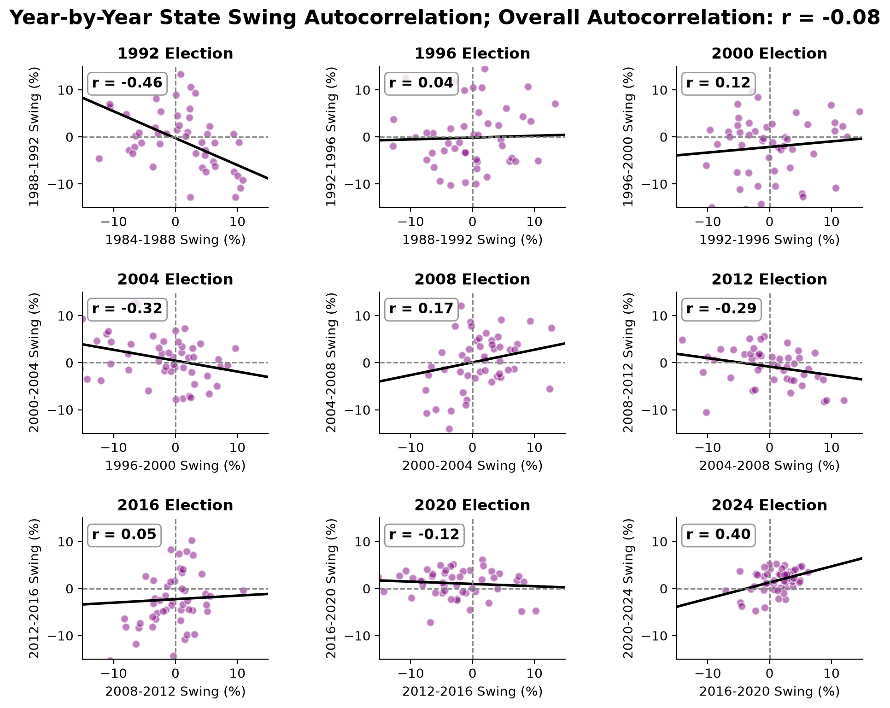

This project concerns presidential elections in the United States from 1980 to 2024.  The main focus will be on the margin of the two-party vote share in each state. For example, suppose that in a given year the Democratic candidate receives 55% of the two-party vote (the combined vote for the Democratic and Republican candidates) in State A and 40% in State B. Then the "Democratic Raw Margin" in State A is 55 - 45 = 10, and in State B it is 40 - 60 = -20.

A state's vote margin can be thought of as consisting of two components: the national vote margin and the state's deviation from the national margin. That second component is useful for analyzing how states shift relative to each other from election to election and how these shifts contribute to the Electoral College results. We define a state's "Democratic Adjusted Margin" by subtracting the national Democratic margin of the two-party vote share from the Democratic Raw Margin of that state.

To illustrate, this chart shows both the Democratic Raw Margin and the Democratic Adjusted Margin for a single state, Wisconsin, in each of the elections from 1980 to 2024. (Observations)

This chart shows the Democratic Adjusted Margin for every state (plus Washington DC) for each of the elections from 1980 to 2024. Note that values above zero mean that the Democratic candidate performed better in that state than in the nation as a whole, whereas values below zero indicate the same for the Republican candidate. (Observations)

One question this data can help us answer: if a state swings in one direction from one election to the next, in the following election is it more likely to swing in the same direction, the opposite direction, or is there no clear pattern? By looking at the Democratic Adjusted Margin, we can factor out swings in the national popular vote and focus on how states swing relative to each other.

This chart shows, for the nine most recent presidential elections and for each state, the lag-1 autocorrelation of the swing in the Democratic Adjusted Margin. That is, each subchart shows the swing in the Democratic Adjusted Margin from the previous election (for example, the swing from 2020 to 2024) plotted against the same swing but to the previous election from the one before that (in the same example, 2016 to 2020). The overall lag-1 autocorrelation is r = -0.08, fairly close to zero. When we look at the individual elections, a pattern emerges: of the five elections in the sample where an incumbent president ran for re-election (1992, 1996, 2004, 2012, and 2020), four have a correlation below zero (and the fifth, 1996, is close to zero with r = 0.04). Conversely, of the four elections in the sample without an incumbent running (2000, 2008, 2016, and 2024), all four have correlation values above zero. In other words, states are more likely to continue trending in the same partisan direction in an election between two non-incumbent candidates and more likely to reverse the direction of recent trends in an election between the incumbent president and a challenger.