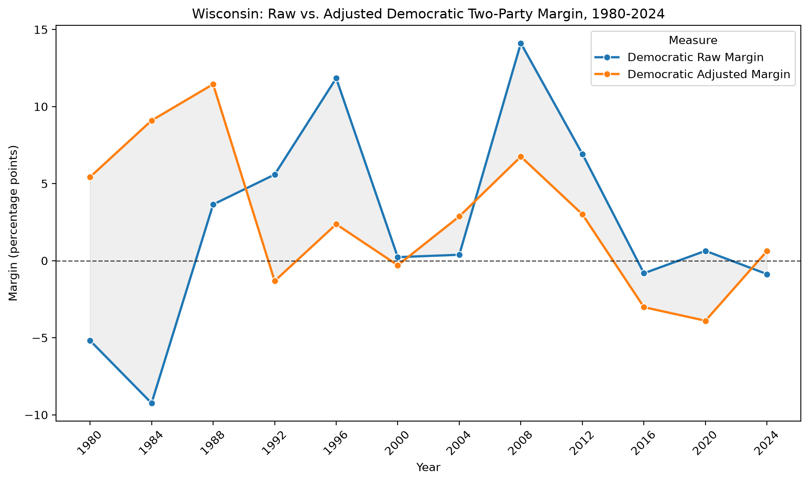
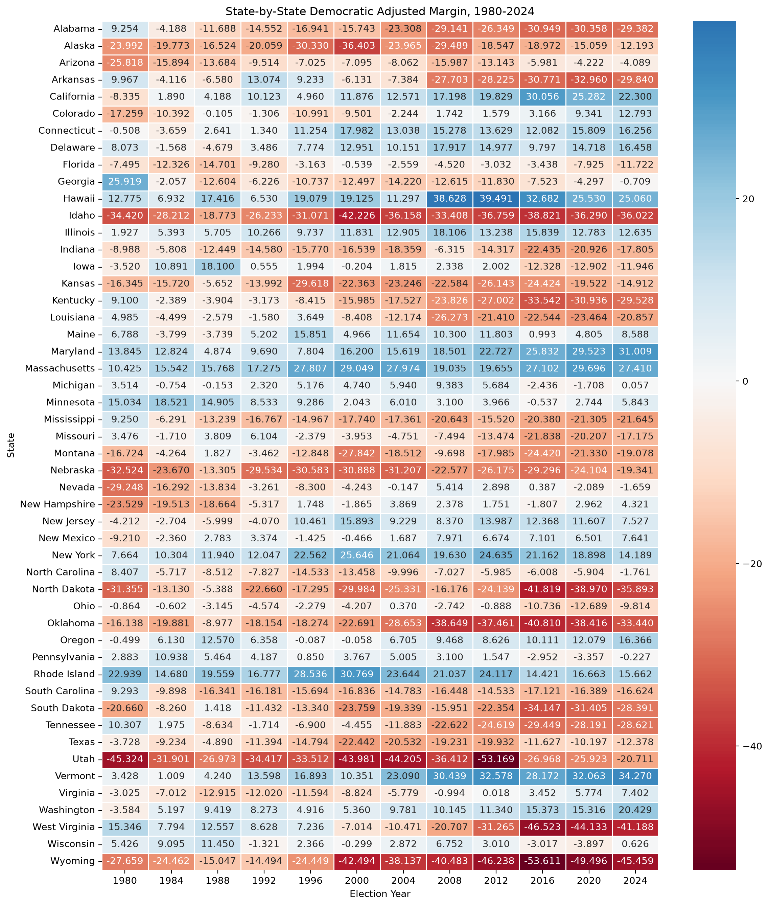

# Analysis of US Presidential Elections, 1980-2024

## Margins Explained

This project concerns presidential elections in the United States from 1980 to 2024.  The main focus will be on the margin of the two-party vote share in each state (that is, votes for third-party candidates are excluded). For example, in the 2008 election in Pennsylvania, Democrat Barack Obama received 3,276,363 votes (55.23%) and Republican John McCain received 2,655,885 votes (44.77%). I call the difference between these vote shares (D minus R, in percentage points) the "Democratic Raw Margin". So for Pennsylvania in 2008, the Democratic Raw Margin would be 55.23 - 44.77 = 10.46.

A state's vote margin can be thought of as consisting of two components: the national vote margin and the state's deviation from the national margin. That second component is useful for analyzing how states shift relative to each other from election to election and how these shifts contribute to the Electoral College results. I define a state's "Democratic Adjusted Margin" by subtracting the national Democratic margin of the two-party vote share from the Democratic Raw Margin of that state. In the previous example, Barack Obama won the popular vote in the 2008 election by 7.36 percentage points, so the Democratic Adjusted Margin for Pennsylvania would be 10.46 - 7.36 = 3.10.

To illustrate, this chart shows both the Democratic Raw Margin and the Democratic Adjusted Margin for a single state, Wisconsin, in each election from 1980 to 2024. The Democratic Raw Margin is positive in years when the Democratic candidate won Wisconsin, and negative in years when the Republican candidate won the state. By contrast, the Democratic Adjusted Margin is positive when the Democratic candidate performed better in Wisconsin than in the national popular vote, and negative in years when they performed worse. Each measure can vary independently from the other based on state and national trends. In 2020, the Democratic Raw Margin was positive but the Democratic Adjusted Margin was negative, meaning that the Democratic candidate, Joe Biden, won Wisconsin but by less than he won the national popular vote. This was reversed in 2024, when the Democratic Raw Margin was negative but the Democratic Adjusted Margin was positive. In that case, Democrat Kamala Harris performed better in Wisconsin than she did nationally but still lost the state.

## State-by-State Patterns

This chart shows the Democratic Adjusted Margin for every state (plus Washington DC) for each of the elections from 1980 to 2024. Some states (Massachusetts, Nebraska) consistently vote to the left or to the right of the nation, while others (Michigan, Wisconsin) vary from election to election. Some states (West Virginia) went from generally left-leaning to generally right-leaning; others (Colorado) did the opposite. Some (Arkansas) were previously competitive but have recently leaned in one direction consistently, and the reverse is true for others (Nevada). No state consistently shifted in the same direction in every election, even states like California with a clear overall trend.

One question this data can help us answer: if a state swings in one direction from one election to the next, in the following election is it more likely to swing in the same direction, the opposite direction, or is there no clear pattern? By looking at the Democratic Adjusted Margin, we can factor out swings in the national popular vote and focus on how states swing relative to each other.

## Swing Autocorrelations

This chart shows, for the nine most recent presidential elections and for each state, the lag-1 autocorrelation of the swing in the Democratic Adjusted Margin. That is, each subchart shows the swing in the Democratic Adjusted Margin from the previous election (for example, the swing from 2020 to 2024) plotted against the same swing but to the previous election from the one before that (in the same example, 2016 to 2020). The overall lag-1 autocorrelation is r = -0.08, fairly close to zero. When we look at the individual elections, a pattern emerges: of the five elections in the sample where an incumbent president ran for re-election (1992, 1996, 2004, 2012, and 2020), four have a correlation below zero (and the fifth, 1996, is close to zero with r = 0.04). Conversely, of the four elections in the sample without an incumbent running (2000, 2008, 2016, and 2024), all four have correlation values above zero. In other words, states are more likely to continue trending in the same partisan direction in an election between two non-incumbent candidates and more likely to reverse the direction of recent trends in an election between the incumbent president and a challenger.